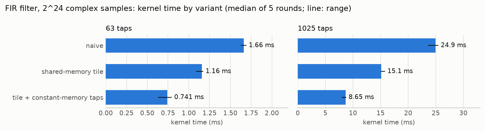
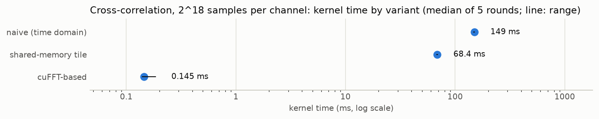

# gpu-rf-pipeline

[](https://github.com/Jeanm2005/gpu-rf-pipeline/actions/workflows/ci.yml)


GPU signal processing for recorded radio data: an FFT spectrum, FIR filtering, and
cross-correlation in CUDA C++, verified against a NumPy/SciPy reference and optimized kernel by
kernel with Nsight. It ships with **SigFlow**, a small dataflow language whose compiler schedules
a pipeline, plans its GPU memory, fuses kernels, and generates a CUDA program for it.

## Highlights

- **Three operations, nine kernels.** Every implementation variant stays selectable
  (`--impl`), so each optimization is measured against the one before it.
- **Measured speedups.** The FIR filter runs 2.9× faster than the naive kernel with shared-memory
  tiling and constant-memory taps; cross-correlation runs about 1000× faster through cuFFT.
- **Verified results.** 121 tests check the float64 reference and compare every GPU variant
  against it, with explicit tolerances and edge cases (partial blocks, inputs shorter than the
  filter, zeros, recovery of a known delay).
- **A compiler for the pipeline.** `sigflowc` goes from source to a scheduled graph IR, applies
  dead-node elimination, liveness-based buffer reuse (−40 % GPU memory) and kernel fusion, and
  emits either a script or a standalone CUDA program.

## Results

Measured on an NVIDIA GeForce RTX 5080 Laptop GPU with CUDA 13.4 (driver 617.42). Kernel time
is the median of five rounds of 20 timed runs after 3 warm-up runs, from CUDA events, with
transfers excluded. Memory throughput comes from Nsight Compute.

<picture>
  <source media="(prefers-color-scheme: dark)" srcset="docs/figures/fir_kernel_time-dark.png">
  
</picture>

| FIR, 2^24 samples | Taps | Kernel time | Memory throughput | Speedup |
|---|---|---|---|---|
| naive | 63 | 1.66 ms | 98.8 % | 1.0× |
| shared-memory tile | 63 | 1.16 ms | 98.3 % | 1.44× |
| tile + constant-memory taps | 63 | 0.74 ms | 95.5 % | 2.25× |
| naive | 1025 | 24.9 ms | 93.8 % | 1.0× |
| shared-memory tile | 1025 | 15.1 ms | 98.8 % | 1.65× |
| tile + constant-memory taps | 1025 | 8.65 ms | 99.0 % | 2.88× |

<picture>
  <source media="(prefers-color-scheme: dark)" srcset="docs/figures/xcorr_kernel_time-dark.png">
  
</picture>

| Cross-correlation, 2^18 samples per channel | Kernel time | Memory throughput | Speedup |
|---|---|---|---|
| naive (time domain) | 149.4 ms | 95.9 % | 1.0× |
| shared-memory tile | 68.4 ms | 92.6 % | 2.18× |
| cuFFT-based | 0.145 ms | 57.0 % (conjugate multiply) | about 1000× |

Findings:

- The naive kernels already run near full occupancy; their warps spend 67 to 75 % of their cycles
  waiting on global-memory loads. Staging each block's samples in shared memory removes most of
  those loads, and moving the FIR taps to constant memory removes the rest.
- For cross-correlation the larger gain is algorithmic: the FFT route does `O(N log N)` work
  instead of `O(N²)` and overtakes the time-domain kernels between 2^10 and 2^12 samples per
  channel. It is also more accurate at this size, since the time-domain kernels keep one long
  float32 running sum per lag.
- Once the kernels are fast, transfers dominate: moving the 128 MB FIR input to the GPU and the
  result back takes about 38 ms, against 0.74 ms for the fastest FIR kernel. That is what the
  streaming work on the roadmap addresses.

The full analysis of every iteration, including negative results, is in
[`docs/PROFILING_LOG.md`](docs/PROFILING_LOG.md).

## SigFlow

SigFlow describes a pipeline as a dataflow graph. `sigflowc` compiles it for the kernels above:

```text
a    = capture("fixtures/ch0.cf32", rate=1e6)
b    = capture("fixtures/ch1.cf32", rate=1e6)
la   = a |> fir(taps="fixtures/lowpass.f32")
lb   = b |> fir(taps="fixtures/lowpass.f32")
spec = la |> fft(n=1024) |> magnitude
corr = xcorr(la, lb)

emit spec -> "out/spectrum.f32"
emit corr -> "out/xcorr.cf32"
```

| Stage | What it does |
|---|---|
| Front end | Lexer, recursive-descent parser, semantic analysis (names, types, sample rates, cycles) with caret diagnostics |
| Graph IR | AST to DAG, dead-node elimination, Kahn scheduling with source-order tie-breaking |
| Memory planning | Liveness analysis and buffer-slot reuse: 40 % less GPU memory on the program above |
| Kernel fusion | Batches FIRs that share their taps into one launch |
| Backends | A script of `rfgpu` commands, or a CUDA program that keeps every value on the GPU |
| Viewer | A TypeScript page that draws the IR before and after each pass |

Language reference, compiler design, and measurements: [`compiler/README.md`](compiler/README.md).

## Getting started

### Requirements

- Linux or WSL2 with an NVIDIA GPU and driver
- CUDA Toolkit 12.8 or newer (nvcc, cuFFT)
- CMake 3.24 or newer and a C++17 compiler
- Python 3.10 or newer
- Node.js 20 or newer, only for the DAG viewer

### Build and test

```bash
pip install -r requirements.txt

cmake -S . -B build -DCMAKE_BUILD_TYPE=Release
cmake --build build -j
pytest -q tests/                                  # GPU tests skip without a GPU

cmake -S compiler -B compiler/build
cmake --build compiler/build -j
ctest --test-dir compiler/build --output-on-failure
```

### Usage

```bash
./build/rfgpu spectrum --in tests/fixtures/tone.cf32 --out out/spectrum.cf32 --nfft 1024
./build/rfgpu fir --in tests/fixtures/tone.cf32 --taps tests/fixtures/lowpass.f32 \
                  --out out/fir.cf32 --impl tiled_const
./build/rfgpu xcorr --a tests/fixtures/ch0.cf32 --b tests/fixtures/ch1.cf32 \
                    --out out/xcorr.cf32 --impl fft --bench 20     # prints timings as JSON
./build/rfgpu --help                                               # every operation and variant
```

Samples are `.cf32` files (interleaved little-endian float32 I/Q, the SigMF `cf32_le` layout),
each with a `.json` sidecar holding the sample rate and ground truth. Filter taps are raw float32
`.f32` files.

### Reproducing the measurements

```bash
python tools/gen_bench.py --out out/bench                 # large inputs, not committed
python tools/make_figures.py collect-times                # re-time every variant
python tools/make_figures.py plot                         # regenerate docs/figures/
```

Profiling setup, including enabling GPU performance counters for Nsight Compute under WSL2, is
in [`docs/DEVELOPMENT.md`](docs/DEVELOPMENT.md).

## Project layout

```text
src/                CUDA kernels, the rfgpu CLI, and the rfgpu_ops library
tests/              pytest suites and committed fixtures
tools/              fixture and benchmark generators, CPU reference, figure generation
compiler/           sigflowc: sources, tests, examples, and the DAG viewer
docs/               roadmap, profiling log, development notes, figures, Nsight reports
```

## Documentation

| Document | Contents |
|---|---|
| [`docs/PROFILING_LOG.md`](docs/PROFILING_LOG.md) | Every optimization iteration with its measurements |
| [`docs/ROADMAP.md`](docs/ROADMAP.md) | Status and planned work |
| [`docs/DEVELOPMENT.md`](docs/DEVELOPMENT.md) | Environment, test suites, profiling setup |
| [`compiler/README.md`](compiler/README.md) | The SigFlow language and compiler |
