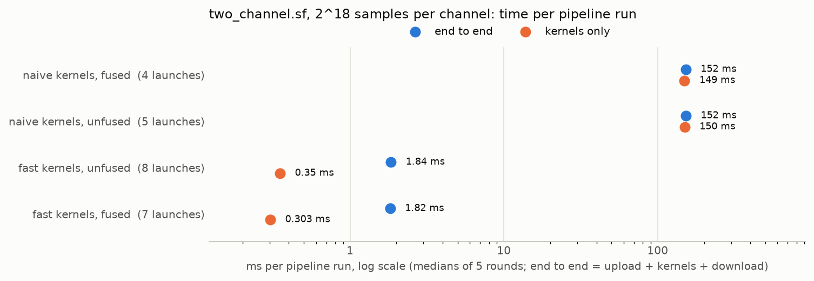

# sigflowc — a compiler for GPU signal-processing pipelines

`sigflowc` compiles **SigFlow**, a small DSL (domain-specific language) for describing radio
signal-processing pipelines, into an execution plan for the hand-written CUDA kernels in
[`gpu-rf-pipeline`](../README.md).

```
# examples/two_channel.sf
a    = capture("fixtures/ch0.cf32", rate=2.4e6)
b    = capture("fixtures/ch1.cf32", rate=2.4e6)
la   = a |> fir(taps="fixtures/lowpass.f32")
lb   = b |> fir(taps="fixtures/lowpass.f32")
spec = la |> fft(n=1024) |> magnitude
corr = xcorr(la, lb)

emit spec -> "out/spectrum.f32"
emit corr -> "out/xcorr.cf32"
```

## Why a compiler

A pipeline is a graph: each stage depends on earlier ones. Running it well means deciding the
launch order, which GPU buffers can be reused, and which stages can be merged into one kernel so
data doesn't make extra round-trips through GPU memory. Those are compiler problems: parsing,
semantic analysis, graph IR (intermediate representation), scheduling, dataflow analysis, and
code generation.

## Compiler stages

| Stage | What it does | Phase | Status |
|---|---|---|---|
| Lexer | Source text → tokens, with line/column positions | A | ✅ |
| Parser | Recursive descent → AST (abstract syntax tree) | A | ✅ |
| Semantic analysis | Name resolution; type, argument, and sample-rate checks | A | ✅ |
| IR builder | AST → DAG (directed acyclic graph) of operations | A | ✅ |
| Scheduler | Topological sort (Kahn's algorithm), cycle detection, source-order tie-breaking | A | ✅ |
| Dead-node elimination | Drops stages that no `emit` depends on | A | ✅ |
| Script backend | Emits an `rfgpu` command script | A | ✅ |
| Liveness analysis | Finds when each buffer is last used, so GPU memory can be reused | B | ✅ |
| DAG viewer | TypeScript page drawing the IR before and after each pass | B | ✅ |
| Kernel fusion | Merges compatible adjacent stages into one kernel | C | ✅ |
| CUDA backend | Emits CUDA C++ calling the existing and fused kernels | C | ✅ |

## The language

### Grammar (EBNF, extended Backus–Naur form)

```
program    = { statement } EOF ;
statement  = ( binding | emit ) NEWLINE ;
binding    = IDENT "=" expr ;
emit       = "emit" IDENT "->" STRING ;
expr       = term { "|>" call } ;               (* a |> f(x) means f(a, x) *)
term       = call | IDENT | literal | "(" expr ")" ;
call       = IDENT "(" [ arg_list ] ")" | IDENT ;
arg_list   = arg { "," arg } ;
arg        = IDENT "=" literal | expr ;         (* keyword args come after positional *)
literal    = NUMBER | STRING ;

IDENT      = letter { letter | digit | "_" } ;
NUMBER     = digit { digit } [ "." digit { digit } ] [ ( "e" | "E" ) [ "-" ] digit { digit } ] ;
STRING     = '"' { any character except '"' or newline } '"' ;
comment    = "#" { any character } NEWLINE ;
```

Notes on the grammar:

- `call = IDENT` and `term = IDENT` overlap. The parser reads a bare `IDENT` as a call only on
  the right of `|>` (`x |> magnitude`); everywhere else it is a reference to a binding.
- Bindings are declarative: a name may be used on a line before the one that defines it. That
  is what makes the program a graph to schedule rather than a list, and what makes a cycle
  (`x = xcorr(a, y)`, `y = x |> fir(...)`) possible and worth reporting.
- `arg` needs two tokens of lookahead: `IDENT "="` starts a keyword argument, any other `IDENT`
  starts an expression.
- Lexing details: a `+` is accepted after the exponent marker (`1e+6`), and `\r\n` line endings
  are accepted.

### Types

| Type | Meaning |
|---|---|
| `stream<cf32>` | Continuous complex float32 samples, with a sample rate |
| `frames<cf32, N>` | Blocks of N complex samples (FFT output) |
| `frames<f32, N>` | Blocks of N real samples (e.g., magnitude spectrum) |

### Built-in operations

| Operation | Signature | GPU implementation |
|---|---|---|
| `capture(path, rate=)` | → `stream<cf32>` | file read |
| `fir(s, taps=)` | `stream<cf32>` → `stream<cf32>` | custom kernel |
| `fft(s, n=)` | `stream<cf32>` → `frames<cf32, n>` | cuFFT |
| `magnitude(f)` | `frames<cf32, N>` → `frames<f32, N>` | element-wise |
| `xcorr(a, b)` | `stream<cf32>`, `stream<cf32>` → `stream<cf32>` (same rate required) | custom kernel |

### Example errors

```
examples/bad_rate.sf:4:8: error: xcorr inputs have different sample rates (2.4e6 vs 1.2e6)
  c = xcorr(a, b)
      ^~~~~
```

## Quick start

```bash
# Build the GPU pipeline first (see ../README.md), then:
cd compiler
cmake -S . -B build -DCMAKE_BUILD_TYPE=Debug
cmake --build build -j

./build/sigflowc examples/two_channel.sf --emit=schedule
./build/sigflowc examples/two_channel.sf -o out/run.sh
ln -sfn ../tests/fixtures fixtures       # the examples read fixtures/*.cf32 (git-ignored link)
RFGPU=../build/rfgpu bash out/run.sh     # writes out/spectrum.f32 and out/xcorr.cf32

# CUDA backend: a program that keeps every value on the GPU
./build/sigflowc examples/two_channel.sf --emit=cuda -o out/run.cu
tools/build_cuda.sh out/run.cu out/run   # links ../build/librfgpu_ops.a
out/run --bench 20 --warmup 3            # same outputs, plus a JSON report of launches,
                                         # GPU memory, and phase times

# Kernel variants, as rfgpu names them (both backends; naive by default)
./build/sigflowc examples/two_channel.sf --emit=cuda --fir-impl=tiled_const --xcorr-impl=fft     -o out/run_fast.cu

ctest --test-dir build --output-on-failure
pytest -q tests/e2e
```

## How it is tested

- **Unit tests** (GoogleTest): lexer, parser, semantic analysis, IR builder, scheduler
  (ordering, tie-breaking, cycles), dead-node elimination, liveness, and fusion, the passes on
  hand-built graphs.
- **Golden tests:** each `tests/golden/*.sf` has an expected `--emit` output or expected
  diagnostics, compared exactly.
- **End-to-end tests** (pytest, `tests/e2e/`): every program in `examples/` is compiled for
  both backends, by default, with `--no-reuse` and `--no-fuse`, and with the tiled and fastest
  kernel variants (`--fir-impl`, `--xcorr-impl`), run on the fixtures, and
  every emitted file is compared to the NumPy/SciPy reference from `../tools/reference.py`,
  evaluated on the same IR (`--emit=json`). Needs `../build/rfgpu` and a GPU; skips otherwise.
  `SIGFLOWC_BIN` and `RFGPU_BIN` point it at other builds.

## Results

Measured on an RTX 5080 Laptop GPU, CUDA 13.4, with `tools/measure.py` (five interleaved
rounds of `--bench 20 --warmup 3`; medians). GPU memory is what the program allocates (slots,
taps, cuFFT workspace); end-to-end time is upload + kernels + download for one pipeline run.
Details, ranges, and the driver-reported memory are in `../docs/PROFILING_LOG.md`.

| Program | Kernel launches (unfused → fused) | GPU memory peak (no reuse → reuse) | End-to-end time (unfused → fused) |
|---|---|---|---|
| `two_channel.sf`, 2^14 samples per channel | 5 → 4 | 983,284 → 590,068 bytes unfused; 655,604 fused with reuse | 1.243 → 1.205 ms (within noise) |
| `two_channel.sf`, 2^18 samples per channel | 5 → 4 | 15,728,884 → 9,437,428 bytes unfused; 10,486,004 fused with reuse | 218.7 → 217.3 ms (within noise) |
| `filter_bank.sf`, fixtures | 3 → 1 | 225,900 bytes unfused, 226,012 fused (both with reuse) | 0.612 → 0.767 ms (transfer noise); kernel phase 0.054 → 0.018 ms |

With the fastest kernels (`--fir-impl=tiled_const --xcorr-impl=fft`), `two_channel.sf` at 2^18
samples per channel runs in 1.82 ms end to end instead of 152.2 ms (84×), and the kernel phase
in 0.303 ms instead of 149.4 ms (494×), at the cost of 31.5 MB of GPU memory instead of
10.5 MB for the FFT work buffers. Transfers are then 83 % of the time.

<picture>
  <source media="(prefers-color-scheme: dark)" srcset="../docs/figures/sigflow_two_channel_bench-dark.png">
  
</picture>

Reuse saves 40 % of `two_channel`'s memory. Fusion removes a launch there but no measurable
time, since the naive cross-correlation dominates, and gives 11 % of the memory back, because
two FIRs in one launch can't hand a buffer from one to the other. Where kernels are tiny and
share their taps (`filter_bank.sf`), fusion makes the kernel phase 2.9× faster.

### Planned GPU memory

`sigflowc --emit=liveness --input-dir=../tests` (and `--no-reuse`) computes the memory plan at
compile time from the fixture sizes: the bytes every value needs if each gets its own buffer,
against one buffer per slot after liveness analysis. Unfused, as in these figures:

| Program | Values | Buffers (no reuse → reuse) | Bytes (no reuse → reuse) | Saved | Busiest step |
|---|---|---|---|---|---|
| `examples/two_channel.sf` | 7 | 7 → 4 | 983,032 → 589,816 | 40.0% | 589,816 |
| `examples/spectrum.sf` | 3 | 3 → 2 | 1,310,720 → 1,048,576 | 20.0% | 1,048,576 |
| `examples/delay.sf` | 5 | 5 → 4 | 684,392 → 604,336 | 11.7% | 604,336 |

In all three, the plan with reuse equals the bytes live at the busiest step, which no plan can go
below, so first-fit assignment is already optimal for these programs.

### Measured GPU memory

`two_channel.sf` compiled with `--emit=cuda`, with and without `--no-reuse`, measured with
`tools/measure.py` (details in `../docs/PROFILING_LOG.md`). "Allocated" is what the program
requests; "driver" is the change in used GPU memory that `cudaMemGetInfo` reports across setup,
in the allocator's 2 MiB pages.

| Input | Allocated (no reuse → reuse) | Driver (no reuse → reuse) |
|---|---|---|
| fixtures, 2^14 samples per channel | 983,284 → 590,068 bytes (−40.0 %) | 12.0 MiB → 12.0 MiB |
| `gen_bench.py`, 2^18 | 15,728,884 → 9,437,428 bytes (−40.0 %) | 26.0 MiB → 20.0 MiB |

The allocation matches the compile-time plan above exactly, and at 2^18 the driver sees the
same 6 MiB saving. Kernel and transfer times are unchanged within the noise.

## Status

Phases A to C are complete (lexer through fusion and the CUDA backend). Open items and later
work are tracked in [`../docs/ROADMAP.md`](../docs/ROADMAP.md).

## Related work

Halide, TVM, and XLA compile array and tensor programs with graph IRs and kernel fusion. GNU
Radio represents radio pipelines as flowgraphs but schedules them at runtime rather than
compiling and fusing them. SigFlow is a small, domain-specific take on the same ideas, built on
hand-written kernels so every fusion decision can be measured.
