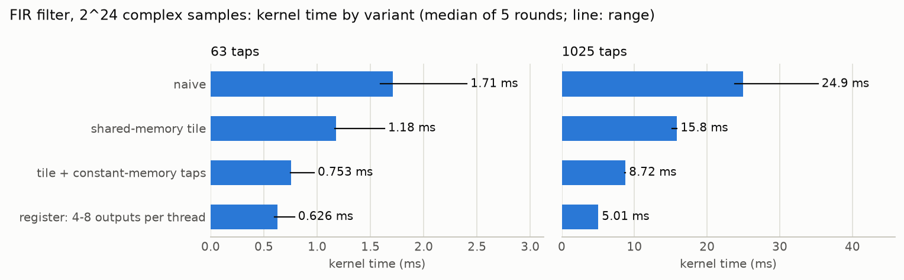
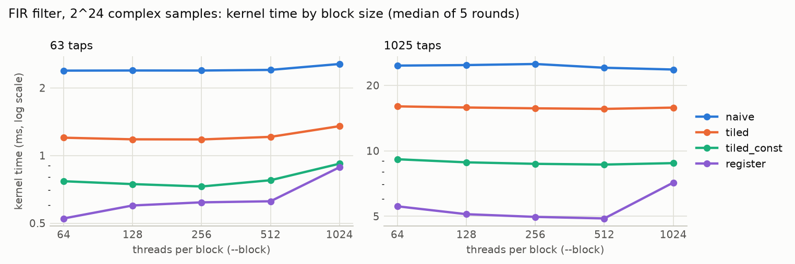
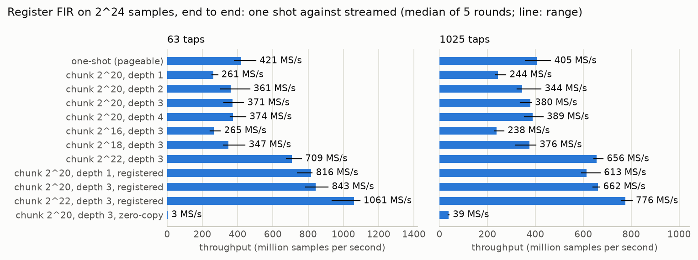
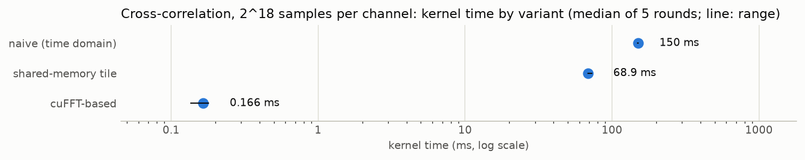
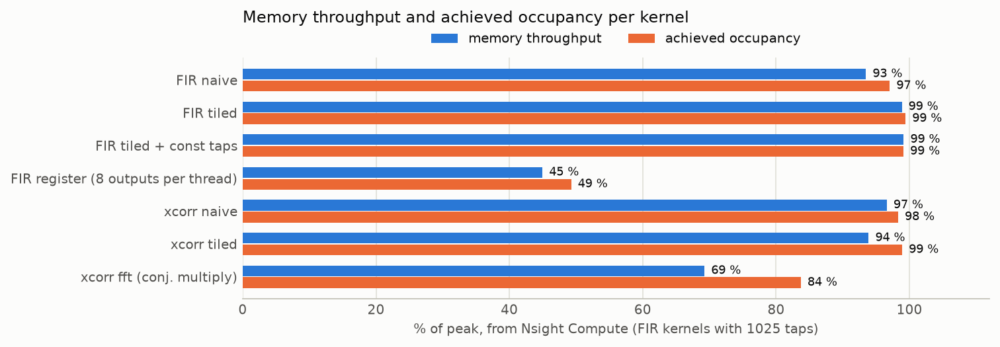
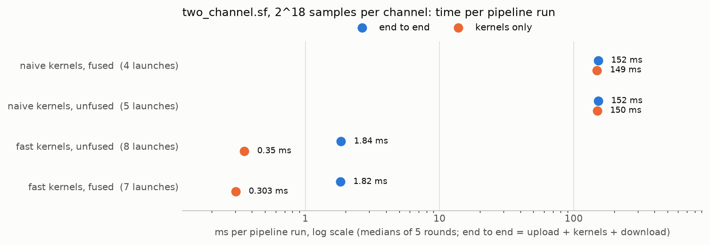

# Profiling log

One entry per optimization iteration, including negative results. Numbers come from Nsight
Systems, Nsight Compute, or CUDA events only. Every timing follows the same rules: warm up,
average at least 10 runs, exclude one-time setup, and report transfer time separately from
kernel time.

Kernel and transfer times are CUDA events from `rfgpu --bench 20` (3 warm-up runs). Per-kernel
metrics come from Nsight Compute (`ncu --set full`), which profiles a single launch at locked
clocks, so its "Duration" is longer than the CUDA-event time and is listed separately. Inputs
come from `python tools/gen_bench.py --out out/bench`. The Nsight Compute reports are in
`docs/profiles/`, and the charts in `docs/figures/` are generated from them and from the
CUDA-event timings by `tools/make_figures.py` (see [`DEVELOPMENT.md`](DEVELOPMENT.md)).

## Summary figures

Generated by `tools/make_figures.py` from `docs/results/`: CUDA-event kernel times re-collected
on 2026-10-30 (CUDA 13.4, driver 617.42; median of five interleaved rounds of `--bench 20
--warmup 3`), and the Nsight Compute metrics of the CUDA 13.4 reports in `docs/profiles/`
(`*.ncu-repz`, recorded on 2026-11-01 by `tools/profile_kernels.sh`). The `*.ncu-rep` reports
are the CUDA 12.8 ones that iterations 0 to 2 cite.











## Iteration 0 — FIR — naive baseline
- GPU / driver / CUDA version: NVIDIA GeForce RTX 5080 Laptop GPU (compute capability 12.0,
  60 SMs) / 572.76 / 12.8
- Input size and parameters: `bench_tone.cf32`, 2^24 samples (128 MB), `--impl naive`, block
  size 256, grid 65536. Two filters: `lowpass.f32` (63 taps) and `lowpass_long.f32` (1025 taps).

| | 63 taps | 1025 taps |
|---|---|---|
| Kernel time (CUDA events, mean ± std) | 1.553 ± 0.009 ms (second round: 1.429 ± 0.004) | 24.43 ± 0.97 ms (second round: 24.41 ± 1.02) |
| Host-to-device transfer | 11.05 ± 0.70 ms | 11.14 ± 0.77 ms |
| Device-to-host transfer | 13.00 ± 1.64 ms | 14.28 ± 1.73 ms |
| `ncu` Duration (SM clock during profiling) | 3.50 ms (970 MHz) | 61.46 ms (935 MHz) |
| Max Bandwidth (% of peak; the busiest memory unit) | 98.83 | 93.81 |
| L1/TEX Cache Throughput | 99.05 % | 93.86 % |
| L2 Cache Throughput | 8.41 % | 1.74 % |
| DRAM Throughput | 15.77 % (71.47 GB/s) | 0.91 % (4.13 GB/s) |
| L1/TEX hit rate / L2 hit rate | 98.48 % / 13.56 % | 99.75 % / 68.06 % |
| Occupancy, theoretical / achieved | 100 % / 89.76 % | 100 % / 97.30 % |
| Registers per thread | 40 | 40 |
| Issue Slots Busy / SM Busy | 27.79 % / 35.08 % | 23.18 % / 31.39 % |
| Eligible warps per scheduler (of active) | 1.74 of 10.76 | 1.73 of 11.68 |
| Warp cycles per issued instruction | 38.71 | 50.38 |

- Top bottleneck reported by the profiler: the L1/TEX cache path, not DRAM and not arithmetic.
  L1/TEX throughput is 94 to 99 % of peak while DRAM is under 16 % and the kernel reaches 8 %
  of the device's fp32 peak (63 taps). The dominant warp stall is "waiting for the L1
  instruction queue for local and global memory operations to be not full": 27.6 of 38.7
  cycles between issued instructions (71.2 %) with 63 taps, 37.7 of 50.4 (74.9 %) with 1025.
  `ncu` also flags uncoalesced global accesses: 51 % of sectors are "excessive", and on
  average only 14.1 of the 32 bytes per sector are used by global loads and 16.0 of 32 by
  global stores.
- What I changed and why: nothing; this is the baseline. Every thread reads each tap and each
  sample from global memory, so the kernel issues `2 * num_taps` loads per output sample
  through L1 and neighbouring threads re-read almost the same samples.
- Result (speedup vs. previous iteration and vs. naive): 1.0× (baseline). With 63 taps the two
  transfers (about 24 ms) take about 15 times longer than the kernel (about 1.5 ms); with 1025
  taps they are about equal to it.
- Reports: `docs/profiles/fir_naive_63.ncu-rep`,
  `docs/profiles/fir_naive_1025.ncu-rep`.

## Iteration 0 — cross-correlation — naive baseline
- GPU / driver / CUDA version: NVIDIA GeForce RTX 5080 Laptop GPU (compute capability 12.0,
  60 SMs) / 572.76 / 12.8
- Input size and parameters: `bench_ch0.cf32` and `bench_ch1.cf32`, 2^18 samples each (2 MB
  each), 524287 lags, `--impl naive`, block size 256, grid 2048.
- Kernel time (mean ± std): 150.5 ± 3.1 ms (second round: 151.3 ± 3.2 ms).
  Transfer time: host-to-device 0.71 ± 0.07 ms, device-to-host 1.17 ± 0.14 ms.
  `ncu` Duration: 317.41 ms at an SM clock of 940 MHz.
- Achieved memory bandwidth (% of peak): Max Bandwidth 95.88 %, set by L1/TEX Cache Throughput
  (96.85 %). L2 Cache Throughput 5.11 %, DRAM Throughput 0.00 % (14.62 MB/s). L1/TEX hit rate
  99.18 %, L2 hit rate reported as 100.39 %.
  Occupancy: theoretical 100 %, achieved 98.19 %, 40 registers per thread.
- Top bottleneck reported by the profiler: the same L1/TEX path as FIR. Both inputs (4 MB
  together) stay in cache, so DRAM is idle, but L1/TEX is at 97 % of peak. Issue Slots Busy is
  33.29 %, with 2.28 of 11.78 active warps eligible per scheduler. The dominant stall is
  again the L1 instruction queue for local and global memory operations: 23.5 of 35.4 cycles
  between issued instructions (66.6 %). `ncu` flags 49 % of sectors as excessive
  (uncoalesced global accesses).
- What I changed and why: nothing; this is the baseline. Every lag re-reads both inputs from
  global memory, about `num_a * num_b` sample pairs in total.
- Result (speedup vs. previous iteration and vs. naive): 1.0× (baseline). Transfers are about
  1 % of the kernel time.
- Report: `docs/profiles/xcorr_naive.ncu-rep`.

## Iteration 1 — FIR — shared-memory tiles (`--impl tiled`)


- GPU / driver / CUDA version: NVIDIA GeForce RTX 5080 Laptop GPU (compute capability 12.0,
  60 SMs) / 572.76 / 12.8
- Input size and parameters: `bench_tone.cf32`, 2^24 samples (128 MB), `--impl tiled`, block
  size 256, grid 65536, `lowpass.f32` (63 taps) and `lowpass_long.f32` (1025 taps). Naive was
  re-timed in the same session. `--bench 20`, 3 warm-up runs.

| | 63 taps | 1025 taps |
|---|---|---|
| Kernel time, naive, same session (mean ± std) | 1.565 ± 0.044 ms | 24.71 ± 0.71 ms |
| Kernel time, tiled (mean ± std) | 1.099 ± 0.023 ms | 15.50 ± 0.97 ms |
| Host-to-device transfer (tiled) | 12.75 ± 0.90 ms | 13.13 ± 1.76 ms |
| Device-to-host transfer (tiled) | 13.99 ± 1.56 ms | 15.16 ± 2.67 ms |
| `ncu` Duration (SM clock during profiling) | 2.58 ms (914 MHz) | 39.04 ms (939 MHz) |
| Max Bandwidth (% of peak; the busiest memory unit) | 98.29 | 98.81 |
| L1/TEX Cache Throughput | 98.55 % | 98.89 % |
| L2 Cache Throughput | 11.19 % | 1.78 % |
| DRAM Throughput | 21.30 % (96.52 GB/s) | 1.42 % (6.45 GB/s) |
| L1/TEX hit rate / L2 hit rate | 82.16 % / 18.53 % | 95.18 % / 71.00 % |
| Dynamic shared memory per block | 2.54 KB | 10.24 KB |
| Occupancy, theoretical / achieved | 100 % / 95.63 % | 100 % / 99.42 % |
| Registers per thread | 39 | 39 |
| Issue Slots Busy / SM Busy | 36.69 % / 36.69 % | 29.94 % / 33.23 % |
| Eligible warps per scheduler (of active) | 1.49 of 11.46 | 1.52 of 11.93 |
| Warp cycles per issued instruction | 31.23 | 39.85 |
| Excessive (uncoalesced) sectors | 20 % | 4 % |

- Top bottleneck reported by the profiler: still the L1/TEX unit at 98 to 99 % of peak, which
  in `ncu` also carries shared-memory traffic. The dominant stall changed from the L1
  local/global queue to "waiting for the MIO (memory input/output) instruction queue": 13.5 of
  31.2 cycles between issued instructions (43.3 %) with 63 taps, 20.6 of 39.8 (51.6 %) with
  1025. The tap loop still does one global load (the tap) and one shared load (the sample)
  per multiply-add.
- What I changed and why: iteration 0 showed warps stalled on global loads, with every thread
  re-reading samples its neighbours also read. Each block now copies the `num_taps - 1 + 256`
  samples it needs into shared memory once (a cooperative, coalesced load that also covers a
  halo longer than the block), and the tap loop reads samples from the tile. Samples outside
  the input are stored as zeros, so the loop has no bounds test. Taps are unchanged (global
  memory). Shared memory does not limit occupancy at either filter length (block limit from
  shared memory 18 and 9, from registers and warps 6).
- Result (speedup vs. previous iteration and vs. naive): 1.42× with 63 taps and 1.59× with
  1025 taps (naive is the previous iteration). Output is bit-identical to naive on the
  benchmark input for both filters. Transfers are unchanged and still about 25 times the
  kernel time with 63 taps.
- Reports: `docs/profiles/fir_tiled_63.ncu-rep`,
  `docs/profiles/fir_tiled_1025.ncu-rep`.

## Iteration 2 — FIR — taps in constant memory (`--impl tiled_const`)


- GPU / driver / CUDA version: NVIDIA GeForce RTX 5080 Laptop GPU (compute capability 12.0,
  60 SMs) / 572.76 / 12.8
- Input size and parameters: `bench_tone.cf32`, 2^24 samples (128 MB), `--impl tiled_const`,
  block size 256, grid 65536, `lowpass.f32` (63 taps) and `lowpass_long.f32` (1025 taps).
  Naive and tiled were re-timed in the same session. `--bench 20`, 3 warm-up runs, two rounds
  (the second round is in parentheses).

| | 63 taps | 1025 taps |
|---|---|---|
| Kernel time, naive (mean ± std) | 1.559 ± 0.023 ms (1.445 ± 0.034) | 23.74 ± 1.08 ms (23.74 ± 1.01) |
| Kernel time, tiled | 1.130 ± 0.041 ms (1.041 ± 0.031) | 15.10 ± 0.55 ms (15.20 ± 0.69) |
| Kernel time, tiled_const | 0.655 ± 0.008 ms (0.660 ± 0.017) | 8.22 ± 0.20 ms (8.32 ± 0.27) |
| Host-to-device transfer (tiled_const) | 12.44 ± 1.08 ms | 12.94 ± 1.83 ms |
| Device-to-host transfer (tiled_const) | 12.99 ± 0.71 ms | 15.16 ± 1.81 ms |
| `ncu` Duration (SM clock during profiling) | 1.45 ms (893 MHz) | 19.72 ms (934 MHz) |
| Max Bandwidth (% of peak; the busiest memory unit) | 94.51 | 98.90 |
| L1/TEX Cache Throughput | 95.93 % | 99.12 % |
| L2 Cache Throughput | 18.24 % | 3.06 % |
| DRAM Throughput | 38.11 % (172.69 GB/s) | 2.81 % (12.71 GB/s) |
| L1/TEX hit rate / L2 hit rate | 52.89 % / 13.81 % | 49.65 % / 67.23 % |
| Dynamic shared memory per block | 2.54 KB | 10.24 KB |
| Occupancy, theoretical / achieved | 100 % / 94.64 % | 100 % / 99.08 % |
| Registers per thread | 27 | 27 |
| Issue Slots Busy / SM Busy | 62.52 % / 62.52 % | 54.76 % / 54.76 % |
| Eligible warps per scheduler (of active) | 2.24 of 11.26 | 1.98 of 11.89 |
| Warp cycles per issued instruction | 18.02 | 21.71 |
| Excessive (uncoalesced) sectors | 53 % (10.6 million) | 50 % (25.2 million) |

- Top bottleneck reported by the profiler: L1/TEX is still the busiest unit (96 to 99 % of
  peak) and the MIO queue is still the largest stall, but smaller: 6.1 of 18.0 cycles between
  issued instructions (33.6 %) with 63 taps, 9.7 of 21.7 (44.7 %) with 1025. Issue Slots Busy
  rose from 30 to 37 % to 55 to 63 %, so the schedulers issue instructions about twice as
  often. What remains on the global path is the tile load and the output store, which `ncu`
  flags as using only about half of each 32-byte sector. The count of excessive sectors is
  the same as in iteration 1 (10.6 and 25.2 million); the percentage is higher only because
  the tap loads no longer count as global sectors.
- What I changed and why: iteration 1 left one global load (the tap) per multiply-add, and the
  MIO queue was the top stall. The taps now live in a `__constant__` array filled with
  `cudaMemcpyToSymbol`; every thread of a warp reads the same tap in the same loop iteration,
  which the constant cache serves without a global-memory request. The kernel is otherwise
  identical to `tiled`. The host limits this variant to 8192 taps.
- Result (speedup vs. previous iteration and vs. naive): vs. tiled 1.73× (63 taps) and 1.84×
  (1025 taps); vs. naive 2.38× and 2.89× (first round). Output is bit-identical to `tiled` on
  the benchmark input for both filters. With 63 taps the kernel (0.66 ms) is now about 2.6 %
  of the transfer time (about 25 ms), so further kernel work on this filter length changes
  end-to-end time very little.
- Reports: `docs/profiles/fir_tiled_const_63.ncu-rep`,
  `docs/profiles/fir_tiled_const_1025.ncu-rep`.

## Iteration 1 — cross-correlation — shared-memory tiles (`--impl tiled`)


- GPU / driver / CUDA version: NVIDIA GeForce RTX 5080 Laptop GPU (compute capability 12.0,
  60 SMs) / 572.76 / 12.8
- Input size and parameters: `bench_ch0.cf32` and `bench_ch1.cf32`, 2^18 samples each, 524287
  lags, `--impl tiled`, block size 256 (also the chunk length), grid 2048, 6.14 KB of dynamic
  shared memory per block. `--bench 20`, 3 warm-up runs; naive re-timed in the same session.
- Kernel time (mean ± std): 68.7 ± 2.4 ms (naive, same session: 150.6 ± 4.5 ms).
  Transfer time: host-to-device 0.74 ± 0.10 ms, device-to-host 1.23 ± 0.30 ms.
  `ncu` Duration: 127.57 ms at an SM clock of 933 MHz (naive: 317.41 ms at 940 MHz).
- Achieved memory bandwidth (% of peak): Max Bandwidth 92.42 %, L1/TEX Cache Throughput
  93.58 %, L2 Cache Throughput 2.91 %, DRAM Throughput 0.01 %. L1/TEX hit rate 63.78 %, L2 hit
  rate 99.77 %.
  Occupancy: theoretical 100 %, achieved 98.93 %, 40 registers per thread.
- Top bottleneck reported by the profiler: the MIO (memory input/output) instruction queue,
  8.4 of 18.2 cycles between issued instructions (46.2 %). In iteration 0 it was the L1 queue
  for global loads, 23.5 of 35.4 cycles (66.6 %). Issue Slots Busy rose from 33.29 % to
  65.09 % and eligible warps per scheduler from 2.28 to 3.50. `ncu` flags 54 % of the
  remaining global sectors as excessive (the tile loads and the output store).
- What I changed and why: iteration 0 showed every lag re-reading both inputs from global
  memory, with warps stalled on those loads. A block of 256 lags now walks input `a` in chunks
  of 256 samples; per chunk it stages those 256 samples of `a` and the 511 samples of `b` that
  the block's lags pair with them, and each thread accumulates the chunk from shared memory.
  Indices outside either input are stored as zeros, so the inner loop has no bounds test, and
  the chunk range is the same for every thread of a block, so all threads reach the same
  barriers. Each thread still adds its products in the same order as naive.
- Result (speedup vs. previous iteration and vs. naive): 2.19× (naive is the previous
  iteration). Output is bit-identical to naive at every size in the sweep below.
- Report: `docs/profiles/xcorr_tiled.ncu-rep`.

## Iteration 2 — cross-correlation — cuFFT-based (`--impl fft`), and the three variants compared


- GPU / driver / CUDA version: NVIDIA GeForce RTX 5080 Laptop GPU (compute capability 12.0,
  60 SMs) / 572.76 / 12.8
- Input size and parameters: `python tools/gen_bench.py --xcorr-samples N` for N from 2^8 to
  2^22 samples per channel (the 2^18 pair is identical to `bench_ch0` / `bench_ch1`).
  `--bench 20`, 3 warm-up runs. The FFT length is the next power of two that holds all
  `2N - 1` lags, which is `2N` here.

Kernel time in ms (CUDA events, mean ± std). For `fft` it covers two forward FFTs, the
conjugate-multiply kernel, and the inverse FFT; plan creation is outside the timed region.

| Samples per channel | naive | tiled | fft |
|---|---|---|---|
| 2^8 | 0.020 ± 0.003 | 0.018 ± 0.016 | 0.047 ± 0.028 |
| 2^10 | 0.061 ± 0.040 | 0.026 ± 0.008 | 0.035 ± 0.015 |
| 2^12 | 0.164 ± 0.014 | 0.069 ± 0.008 | 0.034 ± 0.004 |
| 2^14 | 0.733 ± 0.021 | 0.355 ± 0.044 | 0.100 ± 0.027 |
| 2^16 | 9.29 ± 0.06 | 3.99 ± 0.21 | 0.108 ± 0.021 |
| 2^18 | 150.6 ± 4.5 | 68.7 ± 2.4 | 0.140 ± 0.022 |
| 2^20 | not run | not run | 0.464 ± 0.035 |
| 2^22 | not run | not run | 2.42 ± 0.22 |

- Kernel time (mean ± std) at 2^18: 0.140 ± 0.022 ms.
  Transfer time: host-to-device 0.51 ± 0.14 ms, device-to-host 0.63 ± 0.12 ms.
- Achieved memory bandwidth (% of peak) and occupancy, from `ncu` at 2^18. The run has seven
  kernels of 33 to 40 µs each: six cuFFT kernels (two per transform) and
  `xcorr_conj_mul_kernel`.
  - `xcorr_conj_mul_kernel`: Duration 32.51 µs, Max Bandwidth 57.01 % (DRAM Throughput
    57.01 %, L1/TEX 23.10 %, L2 28.91 %), occupancy 100 % theoretical and 72.50 % achieved,
    16 registers per thread, Issue Slots Busy 9.74 %.
  - cuFFT kernels: Max Bandwidth 23 to 27 %, achieved occupancy 33 to 64 % (theoretical 50 %
    or 100 %), 32.77 KB of shared memory per block.
- Top bottleneck reported by the profiler: for `xcorr_conj_mul_kernel`, warps waiting on a
  scoreboard dependency on an L1TEX operation, 81.9 of 90.1 cycles between issued
  instructions (91.0 %). The kernel is two loads, a few multiplies, and a store per element,
  so it waits on data arriving from DRAM; that is the expected profile for a streaming kernel
  over an 8 MB working set. `ncu` flags 50 % of its sectors as excessive.
- What I changed and why: the time-domain kernels do about `N^2` multiply-adds, which no
  memory optimization changes. The correlation theorem gives the same result in
  `O(N log N)`: forward FFT of both inputs, `B * conj(A)` per bin, inverse FFT. Input `a` is
  uploaded rotated left by `num_a - 1` samples, which shifts the circular result so that
  output index `i` already holds lag `i - (num_a - 1)` and no reordering pass is needed. The
  `1 / fft_length` normalization is folded into the conjugate-multiply kernel.
- Result (speedup vs. previous iteration and vs. naive): at 2^18, 490× faster than tiled and
  1070× faster than naive. The FFT version starts to win between 2^10 and 2^12 samples per
  channel: at 2^10 tiled is ahead (0.026 against 0.035 ms, within one standard deviation of
  each other) and at 2^8 both time-domain kernels beat it; from 2^12 up `fft` is fastest. All
  times below about 0.1 ms carry large relative noise. At 2^18 the transfers (1.1 ms) are
  about 8 times the `fft` kernel time.
  Accuracy against the float64 reference at 2^18 (peak value 2.6e5): maximum absolute error
  0.064 for `fft` and 0.72 for naive and tiled, whose single running float32 sum loses more
  precision as the inputs grow. All three recover the true delay of 37 samples at every size.
- Report: `docs/profiles/xcorr_fft.ncu-rep`.

## Re-measurement — all variants — CUDA 13.4 toolchain

Not an optimization: the machine moved from driver 572.76 / CUDA 12.8 to driver 617.42 /
CUDA 13.4, so every variant was re-timed on 2026-10-23 to check that the numbers above still
hold.

- GPU / driver / CUDA version: NVIDIA GeForce RTX 5080 Laptop GPU (compute capability 12.0) /
  617.42 / 13.4
- Input size and parameters: same inputs and launch configurations as iterations 0 to 2
  (`bench_tone.cf32` 2^24 samples with 63 and 1025 taps; `bench_ch0` / `bench_ch1` 2^18
  samples each). `--bench 20`, 3 warm-up runs per measurement, five interleaved rounds over all
  nine configurations. The table gives the median of the five round means, with the range of
  the round means.

| Configuration | Kernel time, CUDA 13.4 (median, range of 5 rounds) | CUDA 12.8 (iterations 0 to 2) | Change |
|---|---|---|---|
| FIR naive, 63 taps | 1.522 ms (1.485 to 1.559) | 1.559 ms | −2 % |
| FIR tiled, 63 taps | 1.071 ms (1.020 to 1.105) | 1.130 ms | −5 % |
| FIR tiled_const, 63 taps | 0.693 ms (0.652 to 0.856) | 0.655 ms | +6 % |
| FIR naive, 1025 taps | 24.62 ms (24.17 to 33.90) | 23.74 ms | +4 % |
| FIR tiled, 1025 taps | 15.26 ms (15.01 to 15.40) | 15.10 ms | +1 % |
| FIR tiled_const, 1025 taps | 8.19 ms (8.11 to 8.25) | 8.22 ms | 0 % |
| xcorr naive | 150.6 ms (149.3 to 152.0) | 150.6 ms | 0 % |
| xcorr tiled | 69.31 ms (68.85 to 69.75) | 68.7 ms | +1 % |
| xcorr fft | 0.112 ms (0.107 to 0.137) | 0.140 ms | −20 % (within noise) |

- Transfer time (median of round means): FIR input host-to-device 11.6 to 12.2 ms and
  device-to-host 13.4 to 14.6 ms, as before. Cross-correlation, time-domain variants:
  host-to-device 0.56 to 0.57 ms, device-to-host 1.06 to 1.11 ms; `fft`: 0.34 and 0.52 ms
  (the `fft` variant uploads into a padded buffer, so its upload is a different set of copies).
- Achieved memory bandwidth and occupancy: Nsight Compute was blocked (`ERR_NVGPUCTRPERM`)
  when the times above were taken. With the counters re-enabled, every variant was profiled
  again on 2026-11-01 (`tools/profile_kernels.sh`, reports `docs/profiles/*.ncu-repz`). `ncu`
  ran the kernels at an SM clock of 1.46 to 1.50 GHz, against about 0.94 GHz for the CUDA 12.8
  reports, so its Durations are shorter than in iterations 0 to 2:

| Kernel | `ncu` Duration | L1/TEX throughput | DRAM throughput | Achieved occupancy | Dominant stall (cycles per issued instruction) |
|---|---|---|---|---|---|
| FIR naive, 63 taps | 2.34 ms | 96.3 % | 15.5 % | 89.6 % | L1 instruction queue for global memory (20.1) |
| FIR tiled, 63 taps | 1.58 ms | 98.4 % | 22.9 % | 95.4 % | MIO queue (12.9) |
| FIR tiled_const, 63 taps | 0.88 ms | 95.8 % | 41.6 % | 94.3 % | MIO queue (5.5) |
| FIR naive, 1025 taps | 38.39 ms | 93.5 % | 1.0 % | 97.0 % | L1 instruction queue for global memory (26.3) |
| FIR tiled, 1025 taps | 24.43 ms | 98.9 % | 1.5 % | 99.4 % | MIO queue (20.5) |
| FIR tiled_const, 1025 taps | 12.29 ms | 99.2 % | 3.0 % | 99.1 % | MIO queue (10.1) |
| xcorr naive | 197.85 ms | 97.3 % | 0.0 % | 98.4 % | L1 instruction queue for global memory (23.3) |
| xcorr tiled | 78.61 ms | 94.0 % | 0.0 % | 98.9 % | MIO queue (8.7) |
| magnitude (2^24 samples) | 0.35 ms | 18.2 % | 90.2 % | 78.4 % | scoreboard dependency on a global load (56.9) |

- Top bottleneck reported by the profiler: unchanged from iterations 0 to 2. Every FIR and
  time-domain cross-correlation variant is bound by the L1/TEX unit (94 to 99 % of peak) with
  DRAM mostly idle; naive kernels stall on the global-load queue, the shared-memory variants on
  the MIO queue, and constant-memory taps halve the MIO stall again. The new magnitude report
  is the opposite case: a streaming kernel at 90 % of DRAM bandwidth, which is as fast as it
  can be.
- Noise: the GPU's SM clock moved between about 1700 and 1980 MHz during the runs, with
  `nvidia-smi` reporting power-cap clock limiting. One round in five can be far off (FIR naive
  1025 taps: 33.90 ms against about 24.5 ms in the other four), and a first two-round pass,
  not used here, had outliers of up to 1.6×. Single rounds on this laptop GPU are not
  reliable; compare medians over several rounds.
- What I changed and why: nothing in the code. Toolchain update only.
- Result: kernel times are within ±6 % of the CUDA 12.8 numbers for every time-domain variant,
  which is inside the round-to-round spread, and the `fft` difference is within its noise at
  about 0.1 ms. The speedups in iterations 1 and 2 hold: with the medians above, FIR tiled is
  1.42× (63 taps) and 1.61× (1025 taps) over naive, tiled_const 2.20× and 3.01×, xcorr tiled
  2.17×.
- Data: printed by `compiler/tools/measure.py`; numbers as above.

## Iteration 3 — FIR — block-size sweep (`--block`)

Every FIR launch so far used 256 threads per block, a neutral starting point. `rfgpu fir
--block B` now sets it, and `tools/make_figures.py collect-sweep` times each variant at 64, 128,
256, 512, and 1024 threads on 2026-11-01.

- GPU / driver / CUDA version: NVIDIA GeForce RTX 5080 Laptop GPU (compute capability 12.0) /
  617.42 / 13.4
- Input size and parameters: `bench_tone.cf32`, 2^24 samples, `lowpass.f32` (63 taps) and
  `lowpass_long.f32` (1025 taps). `--bench 20`, 3 warm-up runs, five interleaved rounds over
  all 40 configurations; median of the round means (range in
  `docs/results/fir_block_sweep.csv`). The `register` variant is iteration 4.

| Variant, taps | 64 | 128 | 256 | 512 | 1024 |
|---|---|---|---|---|---|
| naive, 63 | 2.39 ms | 2.39 | 2.39 | 2.40 | 2.55 |
| tiled, 63 | 1.20 | 1.18 | **1.18** | 1.21 | 1.35 |
| tiled_const, 63 | 0.77 | 0.75 | **0.73** | 0.78 | 0.92 |
| register, 63 | **0.53** | 0.60 | 0.62 | 0.63 | 0.89 |
| naive, 1025 | 24.6 | 24.8 | 25.1 | 24.1 | **23.6** |
| tiled, 1025 | 16.0 | 15.8 | 15.7 | **15.6** | 15.8 |
| tiled_const, 1025 | 9.15 | 8.85 | 8.71 | **8.65** | 8.78 |
| register, 1025 | 5.56 | 5.11 | 4.97 | **4.89** | 7.14 |


- Achieved memory bandwidth and occupancy: at 256 threads, as in the CUDA 13.4 table above.
  The profiler already showed 89 to 99 % achieved occupancy for every variant, so a different
  block size had little room to help.
- Top bottleneck reported by the profiler: unchanged by block size. The time-domain kernels
  stay L1/TEX-bound; block size only changes how much of each tile is halo (with 1025 taps
  and 64 threads, 16 samples are loaded per output; with 512 threads, 3).
- What I changed and why: nothing in the kernels; one launch parameter, swept.
- Result: a negative result for the existing variants. From 64 to 512 threads, no variant
  changes by more than 9 %, and 256 is within 1 % of the best block size for `tiled` and
  `tiled_const` at both lengths. 1024 threads is the worst or close to it everywhere: fewer,
  larger blocks leave SMs idle at the tail of the grid and, for the shared-memory variants,
  allow fewer resident blocks. 256 stays the default. The sweep matters for `register`
  (iteration 4), whose larger tiles make the block size a real trade-off.
- Data: `docs/results/fir_block_sweep.csv`.

## Iteration 4 — FIR — outputs in registers, I/Q-split tile (`--impl register`)

- GPU / driver / CUDA version: NVIDIA GeForce RTX 5080 Laptop GPU (compute capability 12.0) /
  617.42 / 13.4
- Input size and parameters: as iteration 3, 256 threads per block. Kernel times from
  `tools/make_figures.py collect-times` (five interleaved rounds, all eleven rfgpu
  configurations, 2026-11-01); Nsight Compute reports `docs/profiles/fir_register_63.ncu-repz`
  and `fir_register_1025.ncu-repz`.

| | 63 taps | 1025 taps |
|---|---|---|
| Kernel time, `tiled_const` (median, range of 5 rounds) | 0.753 ms (0.750 to 0.971) | 8.722 ms (8.702 to 8.752) |
| Kernel time, `register` | 0.626 ms (0.602 to 0.786) | 5.011 ms (5.004 to 5.019) |
| Outputs per thread | 4 | 8 |
| `ncu` Duration (`tiled_const` → `register`) | 0.92 → 0.71 ms | 12.29 → 6.93 ms |
| L1/TEX Cache Throughput | 95.8 → 75.4 % | 99.2 → 45.1 % |
| DRAM Throughput | 39.7 → 52.0 % | 3.0 → 5.2 % |
| Issue Slots Busy | 63.0 → 80.5 % | 54.9 → 88.8 % |
| Registers per thread | 26 → 30 | 26 → 46 |
| Achieved occupancy | 94.3 → 96.1 % | 99.1 → 49.3 % |

- Top bottleneck reported by the profiler: before, the L1/TEX unit at 96 to 99 % with warps
  stalled on the MIO queue (iteration 2 and the CUDA 13.4 table): one shared-memory load per
  multiply-add pair. After, instruction issue: 89 % of issue slots are busy with 1025 taps,
  L1/TEX is down to 45 %, and DRAM is still mostly idle. With 63 taps the kernel is now limited
  by loading its input, with DRAM at 52 %.
- What I changed and why: the profiler said the samples, not the taps, are the problem. Each
  thread now computes R consecutive outputs and keeps the R samples they share in registers, so
  moving to the next tap loads one new sample for all R outputs instead of R samples (the
  window shifts by one). Consecutive threads then read samples R apart, which would put R
  threads of a warp on each shared-memory bank with a tile of interleaved I/Q pairs. The tile is
  therefore split into separate I and Q float arrays (the structure-of-arrays layout the
  roadmap named), padded by one float every 32, which spreads a warp's reads over all 32 banks.
  R is a template parameter: R = 4 at first; profiling the 1025-tap case showed ~21 issued
  instructions per tap per thread, of which 8 were multiply-adds, so R = 8 spreads the loads and
  index arithmetic over twice as many. That made 127 to 1025 taps 1.1× to 1.8× faster again
  but 63 taps 17 % slower, since the larger tile halves the resident blocks and short filters
  are bound by loading the tile. `register` therefore uses R = 8 from 128 taps on and R = 4
  below (measured crossover between 63 and 127 taps).
- Result (speedup vs. previous iteration and vs. naive): 1.20× over `tiled_const` with 63 taps
  and 1.74× with 1025 taps; 2.73× and 4.97× over naive. Outputs match the reference within the
  FIR tolerance (the sum per output runs in the same tap order as before, so results agree with
  `tiled_const` to float32 rounding). R = 8 with 1025 taps needs 76 KB of shared memory at 1024
  threads per block, so the kernel opts in to the device's larger per-block limit.
- Open question: with 1025 taps the kernel is issue-bound at half occupancy; packing I and Q
  as `float2` arithmetic or computing in half precision would cut instructions further, at the
  cost of a different numerical contract.
- Transfer time in this run (median of round means): host-to-device 17.2 to 17.6 ms and
  device-to-host 25.1 to 26.9 ms, about 45 % slower than in the CUDA 13.4 re-measurement. The
  compiler was being built on the same machine during part of the run; transfers use
  pageable host memory and the CPU, kernels do not. Kernel times are unaffected (`tiled_const`
  matches the re-measurement within 6 %).
- Data: `docs/results/rfgpu_times.csv`, `docs/results/fir_block_sweep.csv`.

## Streaming — FIR in chunks through pinned memory and CUDA streams (`rfgpu stream`)

Stage 3's first extension. The FIR is two copies around a sub-millisecond kernel (iteration
4: 0.6 ms of kernel against about 40 ms of transfers for 2^24 samples), so the question is
how much of the copying overlapping and pinned memory can remove. Measured on 2026-11-02 with
`tools/make_figures.py collect-stream`.

- GPU / driver / CUDA version: NVIDIA GeForce RTX 5080 Laptop GPU (compute capability 12.0) /
  617.42 / 13.4, PCIe Gen 5 x8, on AC power
- Input size and parameters: `bench_tone.cf32`, 2^24 samples, `--impl register`, 63 and 1025
  taps. `--bench 20`, 3 warm-up passes, five interleaved rounds (zero-copy: 3 runs, in a pass
  of its own after the rounds, see below). "One-shot" is `rfgpu fir`: upload + kernel +
  download from pageable memory, CUDA events. Streamed times are wall clock from the first
  chunk to the last output in the host array. Median of the round means, with their range.

| Configuration | 63 taps | 1025 taps |
|---|---|---|
| One-shot, pageable | 39.8 ms (421 MS/s) | 41.4 ms (405 MS/s) |
| Ring, chunk 2^20, depth 1 (serial) | 64.3 ms | 68.7 ms |
| Ring, chunk 2^20, depth 2 / 3 / 4 | 46.5 / 45.2 / 44.8 ms | 48.7 / 44.2 / 43.1 ms |
| Ring, depth 3, chunk 2^16 / 2^18 / 2^22 | 63.3 / 48.4 / 23.7 ms | 70.4 / 44.6 / 25.6 ms |
| Registered, chunk 2^20, depth 1 | 20.6 ms | 27.4 ms |
| Registered, chunk 2^20, depth 3 | 19.9 ms (843 MS/s) | 25.3 ms (662 MS/s) |
| Registered, chunk 2^22, depth 3 | **15.8 ms (1061 MS/s)** | **21.6 ms (776 MS/s)** |
| Zero-copy, chunk 2^20, depth 3 | 6026 ms | 434 ms |


- "Ring" copies each chunk on the host from the input array into a pinned slot, uploads it
  asynchronously, and copies the output back the same way. "Registered" page-locks the input
  and output arrays themselves (`cudaHostRegister`) and copies straight between them and the
  GPU: the case of a receiver that writes into pinned memory. "Zero-copy" lets the kernel read
  and write mapped pinned memory over PCIe.
- Achieved memory bandwidth and occupancy: the kernels are those of iteration 4; what changes
  here is the copies.
- Top bottleneck: the host. With the ring, two single-threaded `memcpy`s through the pinned
  slots cost about what the overlap saves: at 2^20-sample chunks, depth 2 to 4 beats the serial
  ring by 1.4× to 1.6× but not the one-shot path, whose driver-staged pageable copies are as
  fast. Only with 2^22-sample chunks does the ring pull ahead (1.7× and 1.6×). Without
  host copies (registered), the GPU side alone is 1.6× to 2.5× faster than one-shot, and
  overlap adds only 1.03× to 1.08× over the serial registered ring: the kernel is so short that the
  two copy directions are what overlaps.
- Chunk size: 2^16-sample chunks (512 KB) pay per-chunk launch and synchronization overhead;
  2^22 (32 MB) is the fastest here, which for a real receiver means about 4 s of latency at
  1 MS/s. Throughput and latency trade off directly.
- Real time: at the best setting the GPU filters 1061 MS/s with 63 taps and 776 MS/s with 1025,
  1000× the fixtures' 1 MS/s and above any single SDR front end's sample rate (tens to a few
  hundred MS/s).
- Zero-copy is the slowest by far on a discrete GPU: 300× slower with 63 taps, where the
  kernel writes 4 outputs per thread (8-byte writes 32 bytes apart, which PCIe cannot combine),
  and 17× with 1025 taps (8 per thread); both against registered memory at the same chunk size. It is meant for Jetson, where the memory is shared
  (`docs/JETSON.md`). A first collection interleaved it with the other configurations, and
  every configuration timed after the first zero-copy runs became about 2× slower until the
  session ended, the one-shot path included; that run was discarded and zero-copy is now
  timed after everything else.
- What I changed and why: Stage 3, streaming. Output is bit-identical to `rfgpu fir` for every
  variant, chunk size, depth, and memory mode (`tests/test_pipeline.py`).
- Data: `docs/results/stream.csv`.

## SigFlow buffer reuse — `two_channel.sf` — CUDA backend, reuse against `--no-reuse`

Measures the phase B memory plan on the GPU. The phase C CUDA backend (`sigflowc --emit=cuda`)
keeps every value on the device in the buffer slot liveness analysis gave it, so reuse now
changes what is actually allocated. Measured on 2026-10-28 with
`compiler/tools/measure.py` (`--variant= --variant=--no-reuse --rounds 5 --nsys`).

- GPU / driver / CUDA version: NVIDIA GeForce RTX 5080 Laptop GPU (compute capability 12.0) /
  617.42 / 13.4
- Input size and parameters: `compiler/examples/two_channel.sf` (FIR with 63 taps on both
  channels, 1024-point FFT and magnitude of one, naive cross-correlation of the two). Two input
  sizes: the fixtures (2^14 samples per channel) and the `tools/gen_bench.py` captures
  `bench_ch0` / `bench_ch1` (2^18). rfgpu's default (naive) kernels. `--bench 20`, 3 warm-up
  runs, five interleaved rounds; times are the median of the round means, with their range.
- GPU memory. "Allocated" is what the program asked for (slots, taps, cuFFT workspace);
  "driver" is the change in used memory from `cudaMemGetInfo` across setup, which rounds to the
  allocator's 2 MiB granularity and includes the cuFFT plan:

| Input | Slots (no reuse → reuse) | Allocated (no reuse → reuse) | Driver (no reuse → reuse) |
|---|---|---|---|
| fixtures, 2^14 | 7 → 4 | 983,284 → 590,068 bytes (−40.0 %) | 12,582,912 → 12,582,912 bytes (no change) |
| bench, 2^18 | 7 → 4 | 15,728,884 → 9,437,428 bytes (−40.0 %) | 27,262,976 → 20,971,520 bytes (−6,291,456) |

- Kernel time: fixtures 0.928 ms (0.898 to 1.011) without reuse, 0.932 ms (0.910 to 1.200)
  with; bench 249.5 ms (241.6 to 254.9) without, 245.6 ms (230.9 to 256.6) with.
  Transfer time: fixtures host-to-device 0.160 / 0.183 ms and device-to-host 0.216 / 0.242 ms;
  bench 0.805 / 0.792 ms and 1.959 / 1.958 ms (without / with reuse).
- Launches: 5 per pipeline run either way (2 FIR, 1 cuFFT call, 1 magnitude, 1 xcorr), and
  Nsight Systems recorded 5 GPU kernels for one run, so cuFFT ran one kernel for this plan.
- Achieved memory bandwidth (% of peak) and occupancy, from Nsight Compute on 2026-11-01 at
  2^18 (`measure.py --ncu-out`, reports `docs/profiles/sigflow_two_channel.ncu-repz` and
  `sigflow_two_channel_no_reuse.ncu-repz`; both compiled with fusion on). Per kernel, with
  reuse / without: batched FIR 86.8 / 86.1 % memory throughput and 87.3 / 86.8 % achieved
  occupancy; cuFFT `vector_fft<1024>` 25.5 / 26.4 % and 8.6 / 8.9 %; magnitude 39.6 / 40.3 %
  and 74.9 / 73.7 %; naive cross-correlation 96.7 / 96.8 % and 98.4 / 98.3 %. The two plans
  run identical kernels at identical utilization.
- Top bottleneck reported by the profiler: the naive cross-correlation, 197.7 ms of `ncu`
  Duration against under 0.12 ms for the other three kernels together, bound by L1/TEX (97 %)
  and stalled on the global-load queue, as in its rfgpu report.
- What I changed and why: nothing in the kernels. The slot plan from `src/liveness.cpp` against
  one buffer per value.
- Result: allocated memory drops by 40.0 % at both sizes, exactly the compile-time plan
  (589,816 against 983,032 bytes of slots at 2^14, plus 252 bytes of taps). At 2^18 the driver
  sees the same saving, 6,291,456 bytes, which is the slot difference rounded to whole 2 MiB
  pages. At 2^14 the whole program fits in the same 2 MiB pages either way, so the driver shows
  no difference. Kernel and transfer times do not change beyond the round-to-round spread.
  `cufftGetSize` reported a 0-byte work area for this plan.
- Data: printed by `compiler/tools/measure.py`; numbers as above.

## SigFlow kernel fusion — `two_channel.sf` and `filter_bank.sf` — fused against `--no-fuse`

The phase C fusion pass batches FIRs that share their taps into one launch
(`fir_naive_batched_kernel` in `src/fused.cu`). Measured on 2026-10-28 with
`compiler/tools/measure.py` (`--variant= --variant=--no-fuse --rounds 5 --nsys`); buffer reuse
is on in both variants.

- GPU / driver / CUDA version: NVIDIA GeForce RTX 5080 Laptop GPU (compute capability 12.0) /
  617.42 / 13.4
- Input size and parameters: `two_channel.sf` on the fixtures (2^14 samples per channel) and on
  `bench_ch0` / `bench_ch1` (2^18); `filter_bank.sf` (63-tap low-pass over `tone_odd`, `short`,
  and `zeros`) on the fixtures. Naive kernels throughout. `--bench 20`, 3 warm-up runs, five
  interleaved rounds; times are the median of the round means, with their range. "End-to-end" is
  host-to-device + kernel + device-to-host for one pipeline run, from CUDA events; setup
  (reading files, allocation, cuFFT plans) is excluded.

| Program, input | Launches (unfused → fused) | Kernel time (unfused → fused) | End-to-end (unfused → fused) | Allocated GPU memory (unfused → fused) |
|---|---|---|---|---|
| `two_channel`, 2^14 | 5 → 4 | 0.851 ms (0.843 to 0.860) → 0.854 ms (0.789 to 0.953) | 1.243 → 1.205 ms | 590,068 → 655,604 bytes (+11.1 %) |
| `two_channel`, 2^18 | 5 → 4 | 216.0 ms (207.9 to 219.2) → 214.4 ms (207.2 to 216.7) | 218.7 → 217.3 ms | 9,437,428 → 10,486,004 bytes (+11.1 %) |
| `filter_bank`, fixtures | 3 → 1 | 0.054 ms (0.033 to 0.066) → 0.018 ms (0.018 to 0.028) | 0.612 → 0.767 ms | 225,900 → 226,012 bytes |

- Launches: counted by the program and confirmed by Nsight Systems, which recorded exactly as
  many GPU kernels per pipeline run (cuFFT ran one kernel for its plan).
- Transfer time: fusion does not change what is copied. `two_channel` 2^14: host-to-device
  0.167 / 0.167 ms, device-to-host 0.221 / 0.193 ms (unfused / fused); 2^18: 0.808 / 0.833 ms
  and 1.911 / 1.982 ms; `filter_bank`: 0.299 / 0.409 ms and 0.250 / 0.334 ms. The
  sub-millisecond copies vary by tens of percent between rounds.
- Driver-reported GPU memory (`cudaMemGetInfo` change across setup): `two_channel` 12 MiB either
  way at 2^14, 20 MiB unfused against 22 MiB fused at 2^18; `filter_bank` 2 MiB either way.
- Achieved memory bandwidth (% of peak) and occupancy, from Nsight Compute on 2026-11-01
  (reports `docs/profiles/sigflow_two_channel*.ncu-repz` and `sigflow_filter_bank*.ncu-repz`):

| Program, input | Kernel | `ncu` Duration | Memory throughput | Achieved occupancy |
|---|---|---|---|---|
| `two_channel`, 2^18, fused | `fir_naive_batched_kernel`, grid 1024 × 2 | 88.6 us | 86.8 % | 87.3 % |
| `two_channel`, 2^18, unfused | `fir_naive_kernel` × 2, grid 1024 each | 51.0 + 50.8 us | 80.7 / 80.2 % | 79.4 / 79.3 % |
| `filter_bank`, fused | `fir_naive_batched_kernel`, grid 40 × 3 | 10.5 us | 18.3 % | 22.4 % |
| `filter_bank`, unfused | `fir_naive_kernel`, grids 40, 1, 16 | 9.7 + 5.7 + 9.5 us | 14.0 / 2.5 / 5.8 % | 16.0 / 4.4 / 16.0 % |

- Top bottleneck reported by the profiler: for `two_channel`, the naive cross-correlation
  (197.3 to 197.7 ms of `ncu` Duration in both variants, L1/TEX-bound). For the FIRs, fusion
  helps where the profiler says it should: one batched launch keeps more warps resident (87 %
  against 79 % occupancy at 2^18) and finishes two channels in 88.6 us against 101.8 us for
  two launches. In `filter_bank` the inputs are so short that no variant fills the GPU (at
  most 120 blocks of 256 threads for 60 SMs); `ncu` reports most warps stalled on scoreboard
  dependencies and fetch, i.e. latency, and the batched launch's 10.5 us replaces 24.9 us of
  three launches.
- What I changed and why: fusing FIRs with the same taps saves a launch per extra channel, which
  matters when kernels are short enough for launch overhead to show.
- Result:
  - `filter_bank`: three short FIR launches become one, and the kernel phase is 2.9× faster
    (0.054 to 0.018 ms median), with non-overlapping ranges. The kernels take microseconds, so
    the gaps between launches are most of the total. End-to-end time is not better (0.612 to
    0.767 ms): it is dominated by the transfers, which fusion does not touch and which vary by
    more than the whole kernel phase between rounds.
  - `two_channel`: one launch fewer (5 to 4), but no measurable change in kernel or end-to-end
    time at either size: the ranges overlap, and the two FIRs are a small part of a pipeline
    whose time is the cross-correlation's.
  - Memory cost: fusion costs `two_channel` 11.1 % more allocated GPU memory, because the
    second FIR can no longer reuse the first capture's buffer while the first FIR still reads
    it in the same launch (655,352 against 589,816 bytes of slots, as planned). At 2^18 that
    shows up as 2 MiB more driver-reported memory.
  - Negative result, kept on purpose: for this program, fusion buys a launch and costs memory.
    It pays off when many short kernels share their taps, as in `filter_bank`.
- Data: printed by `compiler/tools/measure.py`; numbers as above.

## SigFlow kernel selection — `two_channel.sf` — naive against the fastest variants

`sigflowc --fir-impl=tiled_const --xcorr-impl=fft` makes the CUDA backend use the fastest FIR
and cross-correlation variants (fusion groups use the batched constant-memory FIR). Measured
on 2026-10-30 with `compiler/tools/measure.py`, four variants per input size, five interleaved
rounds of `--bench 20 --warmup 3`, with Nsight Systems kernel counts. Results are in
`docs/results/sigflow_two_channel_*.json`.

- GPU / driver / CUDA version: NVIDIA GeForce RTX 5080 Laptop GPU (compute capability 12.0) /
  617.42 / 13.4
- Input size and parameters: `compiler/examples/two_channel.sf` on the fixtures (2^14 samples
  per channel) and on `bench_ch0` / `bench_ch1` (2^18). Buffer reuse on. End to end is the
  sum of the median upload, kernel, and download times.

| Variant, 2^18 per channel | Launches (program / Nsight) | Kernel time | End to end | Allocated GPU memory |
|---|---|---|---|---|
| naive, fused | 4 / 4 | 149.4 ms (148.6 to 150.3) | 152.2 ms | 10,486,004 bytes |
| naive, `--no-fuse` | 5 / 5 | 149.7 ms (148.7 to 151.2) | 152.4 ms | 9,437,428 bytes |
| fast, `--no-fuse` | 8 / 11 | 0.350 ms (0.290 to 0.375) | 1.84 ms | 30,408,948 bytes |
| fast, fused | 7 / 10 | 0.303 ms (0.242 to 0.348) | 1.82 ms | 31,457,524 bytes |

| Variant, 2^14 per channel | Launches (program / Nsight) | Kernel time | End to end | Allocated GPU memory |
|---|---|---|---|---|
| naive, fused | 4 / 4 | 0.838 ms (0.751 to 0.856) | 1.30 ms | 655,604 bytes |
| naive, `--no-fuse` | 5 / 5 | 0.779 ms (0.751 to 0.862) | 1.15 ms | 590,068 bytes |
| fast, `--no-fuse` | 8 / 11 | 0.274 ms (0.240 to 0.385) | 0.64 ms | 1,900,788 bytes |
| fast, fused | 7 / 10 | 0.292 ms (0.241 to 0.327) | 0.63 ms | 1,966,324 bytes |



- Launches: the program counts its own calls; the FFT cross-correlation is three cuFFT calls and
  one conjugate-multiply kernel. Nsight Systems records three more GPU kernels than the program
  counts in the fast variants, because cuFFT runs some transforms as more than one kernel.
- Transfer time: at 2^18, upload 0.85 to 0.89 ms with the naive kernels and 0.48 ms with the
  fast ones; download 1.92 against 1.02 to 1.03 ms. The copies are identical in every variant,
  so the difference comes from the GPU's state after a long kernel phase rather than from the
  copies themselves. At 2^14 the uploads and downloads take 0.16 to 0.25 ms in every variant.
- Achieved memory bandwidth (% of peak) and occupancy: per kernel in the entries above; not
  measured again here.
- Top bottleneck: with the fast kernels, transfers are 83 % of end-to-end time at 2^18.
- What I changed and why: the CUDA backend could only call the naive kernels, so the naive
  cross-correlation hid everything else in `two_channel.sf`.
- Result:
  - At 2^18 samples per channel, the fast kernels make the kernel phase 494× faster
    (149.4 to 0.303 ms, fused) and end-to-end time 84× faster (152.2 to 1.82 ms).
  - They cost memory: 31.5 MB allocated against 10.5 MB, mostly the FFT cross-correlation's four
    padded work buffers of 2^19 complex samples each.
  - Fusion with the fast kernels: kernel time 0.350 ms unfused against 0.303 ms fused at 2^18,
    one launch fewer. The ranges overlap (0.290 to 0.375 against 0.242 to 0.348), so the
    13 % gain is likely but not established; at 2^14 there is no difference.
  - With the kernels this fast, the next gains are in transfers: the streaming item on the
    roadmap.

## Entry template

```markdown
## Iteration N — <kernel> — <short name of change>
- GPU / driver / CUDA version:
- Input size and parameters:
- Kernel time (mean ± std):          Transfer time:
- Achieved memory bandwidth (% of peak):     Occupancy:
- Top bottleneck reported by the profiler:
- What I changed and why:
- Result (speedup vs. previous iteration and vs. naive):
- Figure: docs/figures/<name>.png (generated by tools/make_figures.py)
```
